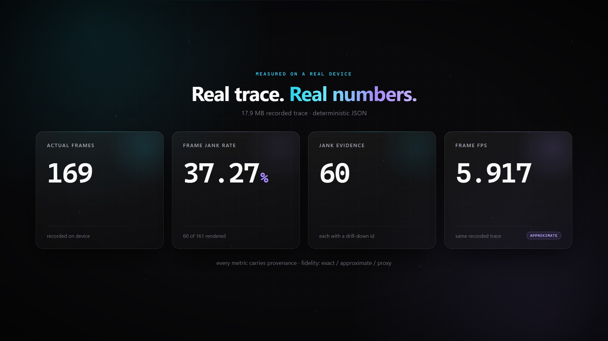

# ohos-perf

**HarmonyOS performance, made measurable.**

[](https://github.com/growvv/ohos-perf/actions/workflows/ci.yml)
[](https://growvv.github.io/ohos-perf/)
[](LICENSE)

A TypeScript toolkit for HarmonyOS performance analysis. It turns an attached device
into structured, evidence-backed data: capability probing, hitrace capture,
`trace_streamer` ingest, typed queries over the resulting SQLite database, frame
metrics with provenance, an evidence graph, and a CLI designed to be called by
agents.

- Website: <https://growvv.github.io/ohos-perf/>
- Design: [`design/2026-11-14-ohos-perf-core-design.md`](design/2026-11-14-ohos-perf-core-design.md)
- P0 plan: [`docs/superpowers/plans/2026-11-14-ohos-perf-core-p0.md`](docs/superpowers/plans/2026-11-14-ohos-perf-core-p0.md)

[](https://growvv.github.io/ohos-perf/#demo)

## Why

HapRay and DevEco Studio are excellent at producing a verdict, but their pipelines
are closed, and an emulator cannot produce every signal. ohos-perf exposes each
stage as a typed seam and makes three promises:

1. **No fabricated numbers.** Every capability is probed and carries a `reason`
   when unavailable; every metric carries `fidelity` (`exact`, `approximate`,
   `proxy`) and `provenance` (collector, table, rows scanned, device).
2. **Deterministic output.** The same input produces byte-identical JSON across
   runs. Metrics are sorted by `id`; evidence is sorted by
   `(kind, window.startNs, id)`.
3. **No native dependencies.** Node's built-in `node:sqlite`, an ESM package, and
   a checked public surface. No native build step, no Python, no bundled binary.

## Status

**P0 is complete**: 291 tests (238 core + 53 CLI-package), three typechecks, and
a full suite that is green on the declared minimum Node (`22.13.0`).

Implemented today:

- `hdc` transport: shell, port forwarding, file send/recv, target listing
- one-shot capability probe → 20 verdicts with evidence
- hitrace collector with marker checks, stale-file protection and stop-on-failure
- `trace_streamer` wrapper and scene layout
- typed frame/process/thread queries over the 88-table trace database
- frame analyzer: count, rendered count, jank rate, empty rate, mean duration, fps
- `Metric` / `Evidence` models with provenance, fidelity and drill-down ids
- `ohos-perf` CLI: `doctor`, `caps`, `analyze`

Not implemented yet (P1): hiperf sampling, hiprofiler-based memory/power/IO,
hidumper live FPS/hitch, uitest UI tree/gestures, the degraded-metric engine,
baseline comparison, and the agent-skill adapter.

## Requirements

- Node **`^22.13.0 || >=23.4.0`**. `node:sqlite` is unavailable unflagged on
  22.5–22.12 and 23.0–23.3; the package imports on those versions and throws an
  actionable `RUNTIME_UNSUPPORTED` error when a database is opened.
- `hdc` and `trace_streamer` from a DevEco Studio installation for live capture
  and ingest. Offline analysis of an existing `trace.db` needs neither.

## Quickstart

The packages are not published to npm yet — install from source.

```bash
git clone https://github.com/growvv/ohos-perf.git
cd ohos-perf
npm install
npm run build
npm run build -w @ohos-perf/cli

node packages/cli/dist/index.js doctor          # what can this device do?
node packages/cli/dist/index.js caps --json     # machine-readable matrix
node packages/cli/dist/index.js analyze ./scene --json
```

`npm test` builds both packages first, so a clean checkout is never red:

```bash
npm test        # 291 root tests (includes 53 CLI tests)
```

## Library

```ts
import { connect, FrameQuery, ProcessQuery, FrameAnalyzer } from '@ohos-perf/core';

const device = await connect();                  // hdc + probe + capability matrix
const caps = await device.capabilities();

const scene = await device.collect({
  app: 'com.example.app',
  durationMs: 10_000,
  sceneRoot: 'scenes/demo',
}).ingest();                                     // hitrace → trace_streamer → trace.db

const result = await new FrameAnalyzer().run({
  frames: new FrameQuery(scene.traceDb),
  processes: new ProcessQuery(scene.traceDb),
  app: { packageName: 'com.example.app', pids: [], processNames: [] },
  window: { startNs: 0, endNs: Number.MAX_SAFE_INTEGER },
  caps,
  deviceId: device.id,
});

console.log(result.metrics);    // Metric[] with provenance + fidelity
console.log(result.evidence);   // Evidence[] with drill-down ids
scene.close();
```

## Capability matrix

Measured on 2026-11-14:

| Device | Available | Notes |
| --- | --- | --- |
| HUAWEI Mate 60, OpenHarmony 7.0.0.111, arm64-v8a | **20 / 20** | hardware PMU, hiprofiler, uitest all present |
| HarmonyOS emulator 6.1.1.125, x86_64 | **9 / 20** | no hiprofiler; `perf.pmu` has no hardware events; `render.fps_live` is a `proxy` |

A missing capability is a value with a `reason` — never a silent zero. See
[`packages/core/src/device/capability.ts`](packages/core/src/device/capability.ts)
for the full rule set.

## Architecture

```
L7  API / CLI / Skill      programmatic API · ohos-perf CLI · agent skill seam
L6  Report                 Metric · Evidence · provenance · fidelity
L5  Analyze                frame analyzer: count · jank · empty · fps (vsync/memory/startup in P1)
L4  Query                  typed accessors over 88 trace tables
L3  Ingest                 trace_streamer wrapper · scene layout · db handle
L2  Collectors             hitrace today; hiperf/hidumper/procfs/uitest probed
L1  Device                 device model · capability probe · matrix
L0  Transport              hdc client
```

## Guarantees and tests

- **Determinism**: `e2e-offline` asserts two runs over a real 17.9 MB trace are
  byte-identical, and that evidence ordering is explicit rather than incidental.
- **Real data**: the recorded trace pins measured values — 169 actual frames,
  161 rendered, 60 stuttered, jank rate 37.267%, 60 jank evidence items with 60
  distinct ids.
- **Failure is never success**: non-zero exits, signal death, missing success
  markers, `[Fail]` on transport stdout and stale dist bundles all fail loudly.
- **Mutation-tested**: 22 deliberate defects were injected during review; each
  surviving one was given a test that now kills it.

## 中文简介

ohos-perf 是一个面向鸿蒙（HarmonyOS / OpenHarmony）的性能分析基础包，使用
TypeScript 编写。它把设备能力探测、hitrace 采集、trace_streamer 入库、类型化
查询、帧指标与证据图串成一条可复现的链路，并提供一个输出稳定 JSON 的 CLI，
方便开发者、CI 与 Agent 直接调用。

三个核心承诺：

1. **不编数字**：能力缺失带原因，指标带 `fidelity` 与 `provenance`。
2. **确定性输出**：同一输入两次运行字节一致，CI diff 有意义。
3. **零原生依赖**：只用 Node 内置 `node:sqlite`，无编译、无 Python。

当前 P0 已实现 hdc 传输、能力矩阵、hitrace 采集、入库、帧/进程/线程查询、帧分析、
Metric/Evidence 与 `doctor` / `caps` / `analyze` 三个命令。P1 将补齐 hiperf、
hiprofiler、hidumper、uitest 采集器与降级指标引擎。

## License

MIT. See [LICENSE](LICENSE).

Not affiliated with Huawei or the OpenHarmony project. Device names are used for
identification only.
